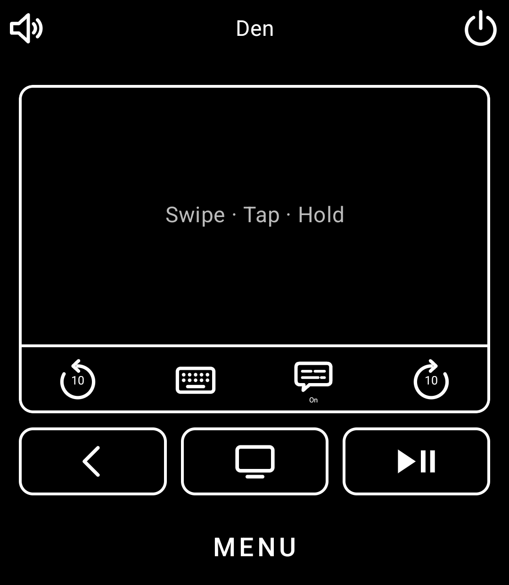
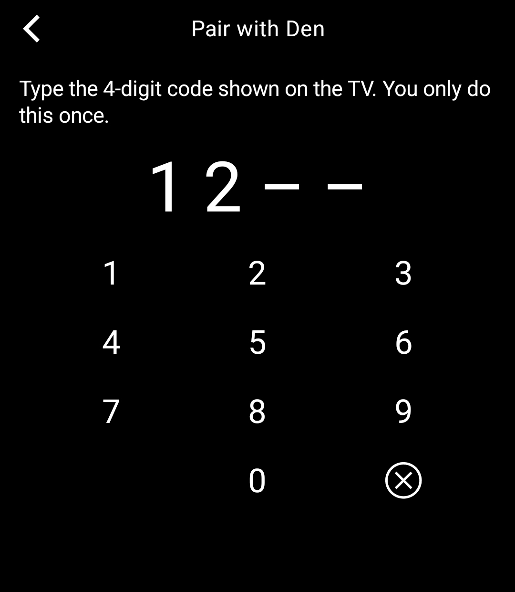
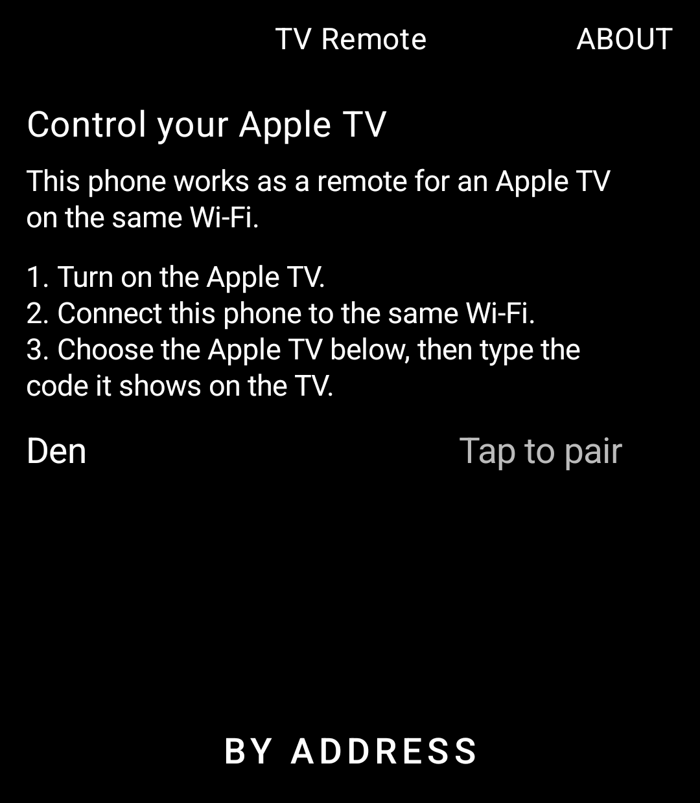

# TV Remote

A remote for your Apple TV, for the Light Phone III. Built with the [Light SDK](https://github.com/lightphone/light-sdk) by Slow Pixels.

> Unofficial. Not made by, affiliated with or endorsed by Apple. Apple TV is a trademark of Apple Inc.

<p>
  
  
  
</p>

- **Finds Apple TVs on your Wi‑Fi** and pairs once with the 4‑digit code the TV shows. If yours isn't found, type its address.
- **Touch surface:** swipe to move, tap to select, hold still for an app's options. Or tap the edge arrows, if you'd rather.
- **Keys:** Back, TV (hold it for Control Center), Play/Pause, skip back and forward 10 seconds, captions.
- **Volume:** the phone's side keys change the TV's volume while the remote is open. Mute at the top left.
- **Keyboard:** when the Apple TV opens a search or sign‑in field, the phone's keyboard comes up and types into it.
- **Power:** put the Apple TV to sleep and wake it from the symbol at the top right.
- **Menu › Settings:** touchpad style, hints, the Apple TV's details, forgetting a pairing.

## Privacy

The tool talks to the Apple TV directly over your Wi‑Fi. No account, no cloud, no analytics: nothing leaves your home network. The pairing key and your choices stay in a small file in the tool's own storage. `lighttool.toml` asks for `INTERNET` (the Wi‑Fi) and `ACCESS_NETWORK_STATE` (to say when the phone isn't on Wi‑Fi).

## How it works, and a note on the protocol

The Apple TV's remote protocol ("Companion") isn't published by Apple. This tool implements it from the descriptions in the open‑source [pyatv](https://github.com/postlund/pyatv) project, as several community remotes do: pairing (SRP‑6a), the session (X25519, Ed25519, ChaCha20‑Poly1305) and the remote commands. The cryptography comes from Bouncy Castle, which is on Light's list. Nothing here uses Apple's code.

That makes it a reverse‑engineered protocol. Apple could change it, and Light's guidelines allow a tool to be refused on legal grounds. It has worked unchanged since 2020 on tvOS 14 through 18.

## How it fits LightOS

- **Finding the Apple TV.** A Light tool can't use Android's service discovery or hold the Wi‑Fi multicast lock, so `net/Mdns.kt` speaks just enough DNS itself. It sends its question from an ordinary port, and a Bonjour responder answers one of those straight back to the sender ("legacy unicast queries", RFC 6762 §6.7): no multicast needs to be received. On a Wi‑Fi that won't pass the question along, **By address** asks the Apple TV directly.
- **The connection lives with the screens** (`ui/Page.kt`): any screen in front keeps the remote connected; leaving the tool lets it go, so it costs nothing in the toolbox.
- **The touch surface** keeps edge swipes for itself (`systemGestureExclusion`), so swiping from its edge moves the Apple TV's focus rather than going back.
- **Side keys** change the TV's volume only while an Apple TV is chosen; otherwise LightOS has them as usual.
- **Typing** uses Light's own text editor and keyboard. Each change goes to the Apple TV after a short pause, into the one field the editor was opened for.

The protocol code (`net/`) and the remote's state (`model/`) have no Android in them, and the tests run them against a fake Apple TV (`src/test`), including pairing with a code, every command, holds, captions, volume, power and typing.

## Building

This is a copy of Light's SDK (version 0.2.3, commit 2f02ecd) with the tool in `tool/`. Build it as any Light tool:

```bash
./gradlew :tool:installDebug
```

To run it on the LightOS emulator, see [the emulator guide](docs/system_app/README.md). The tests:

```bash
./gradlew :tool:testDebugUnitTest
```

To try the tool in the emulator without an Apple TV, `src/test/.../Stand.kt` runs the fake Apple TV on a port (`STAND=49170 ./gradlew :tool:testDebugUnitTest --tests '*Stand'`), and on a Mac `dns-sd -R "Fake Living Room" _companion-link._tcp local 49170 rpMd=AppleTV11,1` announces it. In the tool, **By address** with the host's address (10.0.2.2 from the emulator) finds it; the code is 1234.

## Licence

MIT, as the SDK is. See [LICENSE](LICENSE) for the SDK and [LICENSE-TV-REMOTE](LICENSE-TV-REMOTE) for the code in `tool/`.
